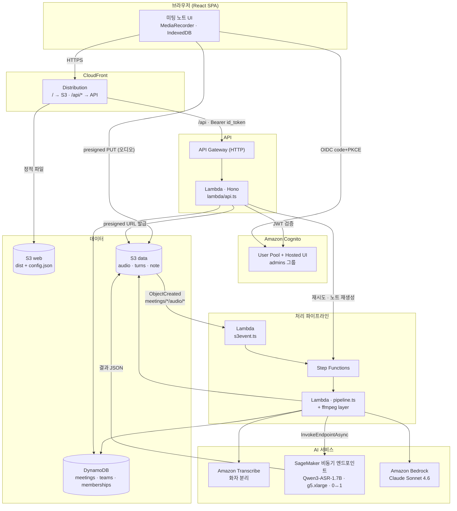
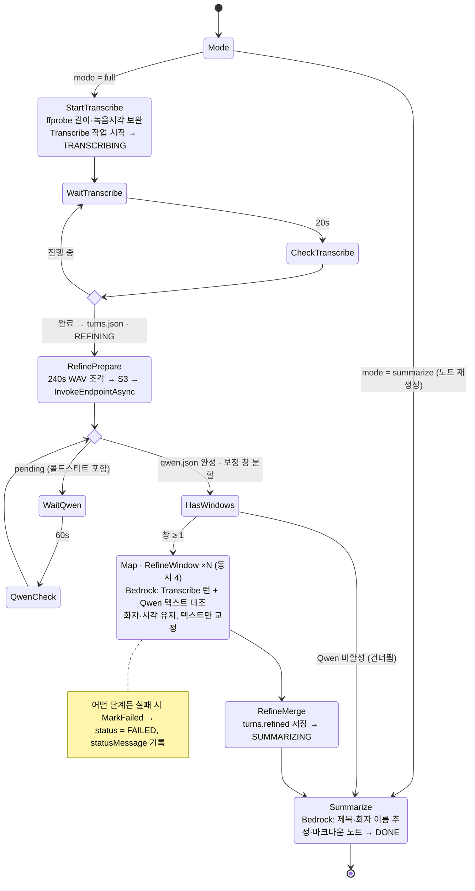
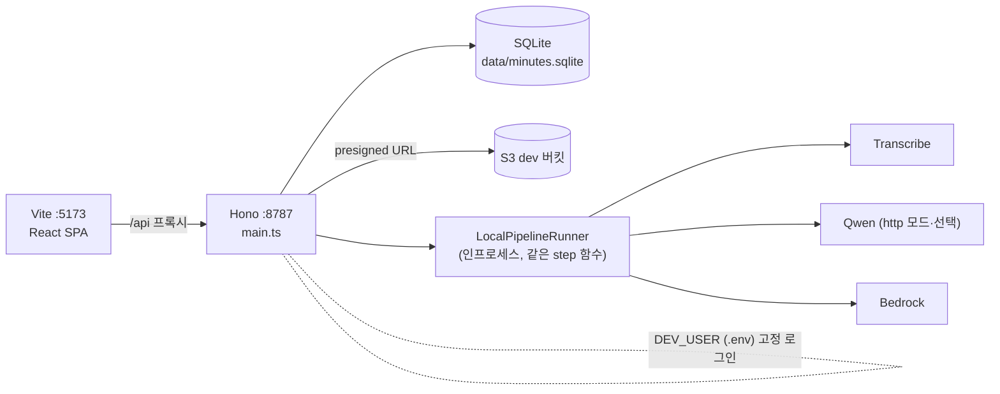

# 미팅 노트 (minutes)

회의를 브라우저에서 녹음하거나 파일을 올리면 **Amazon Transcribe(화자 분리) → Qwen3-ASR(정밀 전사) → Bedrock(두 전사문 대조 보정 + 미팅노트)** 파이프라인을 거쳐 전사문과 마크다운 노트를 만들어 주는 앱입니다.

## 구조

```
packages/
  shared/   타입·zod 스키마 (Meeting, Turn, 상태 enum, API 요청/응답)
  server/   Hono(Node) API + 인프로세스 파이프라인 러너 + SQLite(better-sqlite3)
  web/      React + Vite SPA
```

- **저장소**: 메타데이터는 로컬 SQLite(`packages/server/data/`), 오디오·전사·노트는 S3 (`meetings/{id}/…`). Transcribe가 S3 입력을 요구하므로 로컬에서도 S3를 쓴다.
- **업로드**: `POST /api/uploads` → presigned PUT → 브라우저가 S3에 직접 올림 → `POST /api/uploads/{id}/complete` 로 파이프라인 시작 (배포 시 S3 이벤트로 대체).
- **상태**: `PENDING_UPLOAD → UPLOADED → TRANSCRIBING → REFINING → SUMMARIZING → DONE | FAILED`. 서버 재시작 시 중간 상태 회의는 자동 재개.
- **인증**: 로컬은 `.env`의 `DEV_USER_*` 를 항상 로그인된 사용자로 취급. 배포 시 Cognito JWT 미들웨어로 교체 (`server/src/auth.ts` 한 곳).

## 아키텍처

### 전체 구성 (AWS 배포)



### 전사 → 노트 파이프라인 (Step Functions)



### 로컬 개발



같은 라우트·파이프라인 코드가 인터페이스(`MeetingStore`, `TeamStore`, `UserDirectory`, `PipelineStarter`, 인증 미들웨어)로 로컬/배포 구현을 갈아 끼운다.

| 역할 | 로컬 | AWS |
|---|---|---|
| 회의·팀 저장 | SQLite (`store/sqlite.ts`) | DynamoDB (`store/dynamo.ts`) |
| 사용자 | SQLite | Cognito (`users/cognito.ts`) |
| 인증 | `.env` DEV_USER | Cognito id_token JWT |
| 파이프라인 실행 | 인프로세스 러너 | Step Functions + Lambda |
| 업로드 완료 감지 | 클라이언트 `complete` 호출 | S3 이벤트 (+ `complete` 호출은 no-op) |
| Qwen3-ASR | OpenAI 호환 HTTP(선택) | SageMaker 비동기 엔드포인트 |

## 실행

```bash
cp .env.example .env     # S3_BUCKET, AWS_REGION 등 확인
npm install
npm run dev              # server :8787 + web :5173 (Vite가 /api 프록시)
open http://localhost:5173
```

필요: Node 22+, ffmpeg/ffprobe(`brew install ffmpeg`), AWS credential(S3·Transcribe·Bedrock 권한). Bedrock에서 `BEDROCK_MODEL_ID` 모델 접근이 활성화돼 있어야 한다.

S3 버킷 CORS에 브라우저 origin(`http://localhost:5173`)의 `PUT` 허용이 필요하다 (dev 버킷 `minutes-dev-367833968741` 에는 설정됨).

## Qwen3-ASR 정밀 전사

`QWEN_MODE` 가 `off` 면 REFINING 단계는 건너뛰고 Transcribe 결과로 바로 노트를 만든다. 두 가지 호스팅 방식을 지원한다.

**(배포) SageMaker 비동기 엔드포인트 — `packages/qwen-asr` + `MinutesQwen` 스택**
`pytorch/pytorch` 베이스에 `qwen-asr` 와 모델 가중치(`Qwen/Qwen3-ASR-1.7B`)를 넣은 컨테이너를 `ml.g5.xlarge` 비동기 엔드포인트로 올린다. 요청이 없으면 **0대로 축소**되고 큐에 요청이 쌓이면 1대 기동(콜드스타트 5~10분). 파이프라인은 오디오를 조각내 S3에 올리고 `InvokeEndpointAsync` 로 큐에 넣은 뒤 Step Functions 가 1분 간격으로 결과를 확인한다. 참석자 이름은 `CustomAttributes` 의 `context` 로 전달해 고유명사 인식에 활용한다.

주의: SageMaker `ml.g5` 호스트의 NVIDIA 드라이버는 CUDA 11.4 까지만 지원하므로 베이스 이미지는 **cu118 빌드**(`pytorch/pytorch:2.6.0-cuda11.8-cudnn9-runtime`)를 써야 한다. cu12 빌드는 "driver too old" 로 GPU 초기화에 실패해 CPU 로 떨어지고(240초 조각당 ~8분), Dockerfile 이 빌드 시점에 이를 검사한다. 컨테이너가 추론을 직렬화하므로 `maxConcurrentInvocationsPerInstance` 는 1 이고, 실패한 조각은 `checkQwen` 이 최대 3회 다시 큐에 넣는다.

```bash
# 메인 스택 배포 후 (dataBucketName 출력값을 cdk.json 컨텍스트에 기록)
cd packages/infra && npx cdk deploy MinutesQwen   # 이미지 빌드/푸시 포함, 수십 분
npx cdk deploy Minutes                            # qwenEndpointName 컨텍스트로 파이프라인에 연결
```

**(로컬/테스트) OpenAI 호환 HTTP — `QWEN_ASR_URL`**
vLLM 등으로 `/v1/audio/transcriptions` 를 서빙하면 로컬 러너가 동기 호출한다 (`vllm serve Qwen/Qwen3-ASR-1.7B --port 8000`).

보정 로직은 공통: Transcribe 턴(화자·시각)과 Qwen 텍스트를 Bedrock 에 함께 넣어 **턴 구조는 유지하고 텍스트만 교정** (`server/src/pipeline/refine.ts`), 창 단위로 Step Functions Map 병렬 처리.

## 주요 스크립트

| 명령 | 설명 |
|---|---|
| `npm run dev` | 서버 + 웹 동시 실행 |
| `npm run typecheck` | 전체 타입 체크 |
| `npm run build` | 웹 빌드(`packages/web/dist`) + 서버 빌드. 빌드된 웹이 있으면 서버가 같은 포트에서 정적 서빙 |

## 기능 메모

- 노트 편집기: 마크다운 textarea + 실시간 미리보기.
- `timeSource` 값: `file`(파일 메타) / `recorder` / `manual` / `upload`.
- 공유 범위: `teamIds: []` 가 "나만 보기".
- 추가 기능: 실패한 회의 `다시 처리`, `녹음 듣기`(presigned GET), 업로드 폼에서 공유 범위 선택.
- 로컬 모드에서 비밀번호 변경/로그아웃은 동작하지 않음(UI만 유지).

## AWS 배포 (`packages/infra`, CDK)

- **인증**: Cognito User Pool(Hosted UI, code+PKCE). 브라우저는 `Authorization: Bearer <id_token>` 로 API 호출. 관리자 = Cognito 그룹 `admins`. 팀 멤버십은 DynamoDB(`USER#<sub>/TEAM#<id>`).
- **ffmpeg**: `npm run layer -w @minutes/infra` 가 정적 바이너리를 내려받아 Lambda 레이어로 묶는다 (`layers/ffmpeg/bin`, git 제외).
- **최초 관리자**: `cdk.json` 의 `adminEmail` 로 Cognito 사용자를 만들고 초대 메일(임시 비밀번호)을 보낸다. 이후 사용자는 앱의 "사용자 관리"에서 초대.

```bash
npm run build -w @minutes/web          # dist 가 BucketDeployment 로 올라간다
npm run layer -w @minutes/infra        # 최초 1회
cd packages/infra && npx cdk deploy    # 출력: SiteUrl, UserPoolId, ...
# Qwen3-ASR 켜기: npx cdk deploy -c qwenAsrUrl=http://<vllm-host>:8000
```

로컬 개발은 그대로 `npm run dev` (SQLite + dev 사용자). 로컬 Vite 에서도 Cognito 로그인을 쓰려면 `packages/web/public/config.json` 에 배포 출력값을 넣으면 된다(콜백 URL 에 `http://localhost:5173/` 포함됨).
